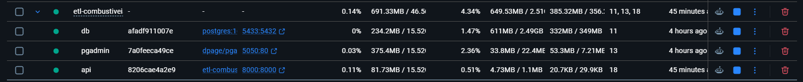
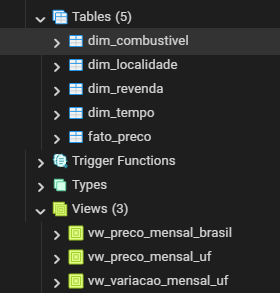
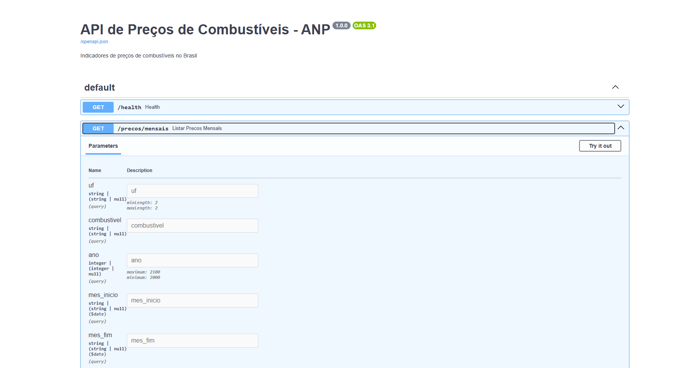
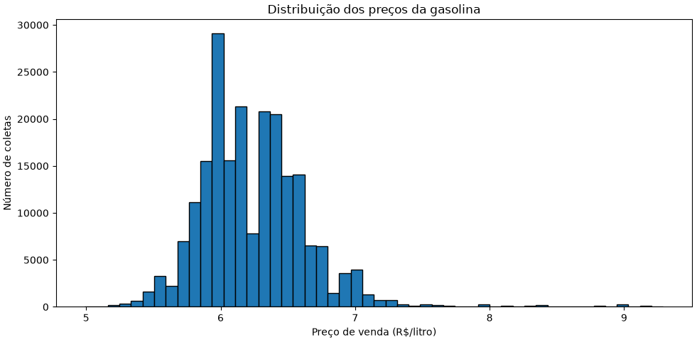

# ETL de Preços de Combustíveis — ANP

Pipeline de engenharia de dados para ingestão, tratamento, validação, armazenamento e análise dos preços de combustíveis comercializados no Brasil, utilizando dados públicos da **Agência Nacional do Petróleo, Gás Natural e Biocombustíveis (ANP)**.
Link para download://www.gov.br/anp/pt-br/centrais-de-conteudo/dados-abertos/serie-historica-de-precos-de-combustiveis

O projeto segue uma arquitetura em camadas **Bronze, Silver e Gold**, com carga incremental, Data Warehouse em PostgreSQL, API REST com FastAPI e análises exploratórias em Jupyter Notebook.

## Arquitetura

```text
Arquivos CSV da ANP (downloads/)
              |
              v
     Controle incremental
       (hash SHA-256)
              |
              v
   Bronze — arquivos originais
              |
              v
  Transformação e validação
              |
              v
 Silver — Parquet particionado
          por ano/mês
              |
              v
  Gold — PostgreSQL (DW)
    |                  |
    v                  v
 Views analíticas    FastAPI
    |                  |
    v                  v
 Pandas/Jupyter    Swagger /docs
```

### Camadas de dados

| Camada | Responsabilidade | Armazenamento |
|---|---|---|
| **Bronze** | Preservar os arquivos CSV originais recebidos | Arquivos locais |
| **Silver** | Padronizar campos, validar registros e separar dados inválidos | Parquet particionado por ano e mês |
| **Gold** | Estruturar os dados para consultas analíticas | PostgreSQL com dimensões, fato e views |

## Funcionalidades

- Ingestão de arquivos CSV semestrais da ANP.
- Tratamento de tipos, datas, preços e demais campos.
- Persistência em Parquet particionado por `ano` e `mes`.
- Modelo dimensional no PostgreSQL.
- Carga de dados com tratamento de conflitos.
- **Processamento incremental por SHA-256:** arquivos já registrados são ignorados em execuções posteriores.
- Execução de um arquivo específico ou de todos os CSVs de um diretório.
- Atualização dos meses afetados na camada Gold.
- Views analíticas de preços mensais e variação percentual.
- API REST para consulta de preços com filtros, ordenação e paginação.
- Análises exploratórias com Pandas, Matplotlib e Jupyter Notebook.
- PostgreSQL, pgAdmin e FastAPI executados via Docker Compose.

## Tecnologias

**Python**, **Pandas**, **PyArrow**, **PostgreSQL**, **Psycopg**, **SQLAlchemy**, **FastAPI**, **Uvicorn**, **Docker Compose**, **Jupyter Notebook** e **Matplotlib**.

## Estrutura do projeto

```text
ETL-Combustiveis/
├── analysis/
│   └── eda_combustiveis.ipynb
├── data/
│   ├── bronze/
│   └── silver/
├── downloads/
├── images/
│   ├── containers.png
│   ├── distribuicao_precos.png
│   ├── swagger.png
│   ├── tabela fato.png
│   └── tables.png
├── scripts/
│   └── init_db.py
├── sql/
│   ├── schema.sql
│   ├── load_gold.sql
│   └── views_gold.sql
├── src/
│   ├── api/
│   │   └── main.py
│   ├── extract/
│   │   └── anp_extractor.py
│   ├── transform/
│   │   ├── fuel_transformer.py
│   │   └── data_validator.py
│   ├── storage/
│   │   ├── parquet_repository.py
│   │   └── postgres_repository.py
│   ├── warehouse/
│   │   └── warehouse_loader.py
│   └── main.py
├── tests/
│   ├── bronze/
│   │   
│   ├── silver/
│   │   
│   ├── gold/
├── docker-compose.yml
├── Dockerfile.api
├── requirements.txt
└── README.md
```

Os diretórios de dados e downloads são usados durante a execução. Os arquivos brutos e processados não precisam ser versionados no Git.

## Como executar

### Pré-requisitos

- Python 3.12 ou versão compatível com as dependências do projeto.
- Docker e Docker Compose.
- Git.
- Arquivos CSV de preços de combustíveis disponibilizados pela ANP.

### 1. Clonar o repositório

```bash
git clone https://github.com/Caio-Hernandes/ETL-Combustiveis.git
cd ETL-Combustiveis
```

### 2. Configurar o ambiente Python

No Windows (PowerShell):

```powershell
python -m venv .venv
.\.venv\Scripts\Activate.ps1
pip install -r requirements.txt
```

### 3. Configurar as variáveis de ambiente

Crie um arquivo `.env` na raiz do projeto:

```dotenv
POSTGRES_HOST=localhost
POSTGRES_PORT=5433
POSTGRES_DB=combustiveis_dw
POSTGRES_USER=etl_user
POSTGRES_PASSWORD=defina_uma_senha_segura

PGADMIN_EMAIL=admin@example.com
PGADMIN_PASSWORD=defina_outra_senha_segura
```

> **Segurança:** não versione o arquivo `.env` nem credenciais reais. Os valores `localhost:5433` são usados pelos scripts Python executados no computador. A API, dentro do Compose, acessa o serviço PostgreSQL pelo endereço interno `postgres:5432`.

### 4. Subir os serviços Docker

```powershell
docker compose up -d --build
```

Serviços disponíveis localmente:

| Serviço | Endereço |
|---|---|
| PostgreSQL | `localhost:5433` |
| pgAdmin | `http://localhost:5050` |
| FastAPI | `http://localhost:8000` |
| Swagger UI | `http://localhost:8000/docs` |

Exemplo dos serviços em execução no Docker Desktop:



### 5. Inicializar o banco de dados

```powershell
python scripts/init_db.py
```

O script aplica a estrutura SQL necessária ao Data Warehouse.

### 6. Adicionar os arquivos CSV

Coloque os arquivos de preços semestrais da ANP na pasta `downloads/`:

```text
downloads/
├── Preços semestrais - AUTOMOTIVOS_2025.01.csv
└── Preços semestrais - AUTOMOTIVOS_2025.02.csv
```

### 7. Executar o pipeline

Processar todos os CSVs diretamente dentro de `downloads/`:

```powershell
python -m src.main --dir downloads
```

Processar apenas um arquivo:

```powershell
python -m src.main --file ".\downloads\Preços semestrais - AUTOMOTIVOS_2025.01.csv"
```

Forçar o reprocessamento:

```powershell
python -m src.main --dir downloads --force
```

O pipeline percorre os arquivos em ordem de nome. Se ocorrer um erro, a execução é interrompida e pode ser retomada após a correção.

## Processamento incremental

Antes de executar o ETL, o sistema calcula o **SHA-256** de cada arquivo e consulta a tabela `etl.arquivos_processados`.

- **Hash já registrado:** o arquivo é ignorado.
- **Hash novo:** o arquivo passa pelas camadas Bronze, Silver e Gold.
- **Carga concluída:** o hash e a quantidade de registros válidos são registrados no PostgreSQL.
- **`--force`:** permite reprocessar arquivos mesmo que já tenham sido registrados.

Na Gold, cada partição mensal processada substitui os fatos daquele mês, enquanto as demais competências permanecem preservadas. O processamento é realizado por mês, em transações individuais.

> **Limitação:** a estratégia atual pressupõe que cada CSV contenha todos os registros dos meses que representa. Arquivos parciais ou sobrepostos podem substituir dados de um mesmo mês. O controle por hash identifica arquivos idênticos, mas não determina automaticamente qual versão de um período é a mais recente.

## Modelo de dados — Gold

O Data Warehouse utiliza um modelo dimensional com as seguintes tabelas:

| Tabela | Descrição |
|---|---|
| `gold.dim_tempo` | Data, ano, mês e trimestre |
| `gold.dim_localidade` | Região, UF e município |
| `gold.dim_combustivel` | Tipo de combustível e unidade de medida |
| `gold.dim_revenda` | Revenda, CNPJ e bandeira |
| `gold.fato_preco` | Observações de preços vinculadas às dimensões |

Exemplo de consulta aos registros carregados na tabela fato:


### Views analíticas

- `gold.vw_preco_mensal_uf`: preços médios, mínimos e máximos por mês, UF e combustível, além de quantidades de coletas e postos pesquisados.
- `gold.vw_preco_mensal_brasil`: indicadores mensais agregados para o Brasil.
- `gold.vw_variacao_mensal_uf`: evolução e variação percentual dos preços médios mensais por UF e combustível.

Tabelas e views da camada Gold no pgAdmin:



## API REST

A API disponibiliza consultas à camada Gold, com documentação interativa pelo Swagger.

| Método | Rota | Descrição |
|---|---|---|
| `GET` | `/health` | Verifica a aplicação e a conexão com o PostgreSQL |
| `GET` | `/precos/mensais` | Consulta preços mensais por UF e combustível |

Exemplos:

```http
GET http://localhost:8000/health
GET http://localhost:8000/precos/mensais?uf=SP&combustivel=GASOLINA&ano=2025
GET http://localhost:8000/precos/mensais?ordenar_por=preco_medio&ordem=desc&limit=10
```

A rota de preços oferece filtros por UF, combustível, ano, intervalo de meses e faixa de preços, além de ordenação e paginação (`limit` e `offset`).

Documentação interativa: **http://localhost:8000/docs**.



## Análises exploratórias

O notebook `analysis/eda_combustiveis.ipynb` utiliza Pandas e Matplotlib para investigar:

- Evolução mensal dos preços de gasolina e etanol.
- Ranking dos estados com preços médios mais altos e mais baixos.
- Comparação da evolução dos preços entre UFs.
- Variação percentual entre o primeiro e o último mês analisados.
- Estatísticas descritivas e distribuição dos preços.
- Resumo automatizado dos principais achados.

Para executar, abra o notebook no VS Code, selecione o interpretador da `.venv` como kernel e execute as células na ordem.

Os resultados variam conforme os arquivos carregados no Data Warehouse.

Exemplo de distribuição dos preços de venda da gasolina, com o número de coletas por faixa de preço:



## Fonte dos dados

Os dados utilizados são provenientes dos levantamentos públicos de preços de combustíveis da **Agência Nacional do Petróleo, Gás Natural e Biocombustíveis (ANP)**. Os CSVs devem ser obtidos diretamente nos canais oficiais de dados da agência.

## Próximas evoluções possíveis

- Controle de versões de arquivos por competência, além do hash.
- Transação única para registro de processamento e atualização da Gold.
- Automatização da obtenção dos CSVs.
- Testes automatizados de qualidade e integração.
- Agendamento e observabilidade das execuções do pipeline.

---

**Projeto de portfólio em Engenharia e Análise de Dados.**
